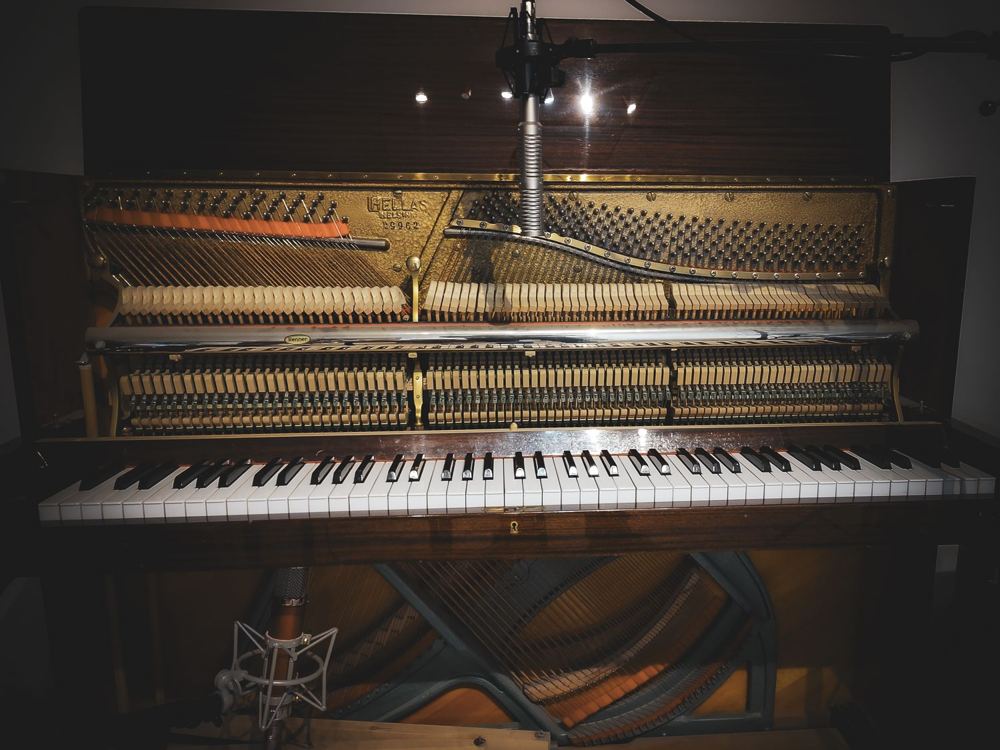
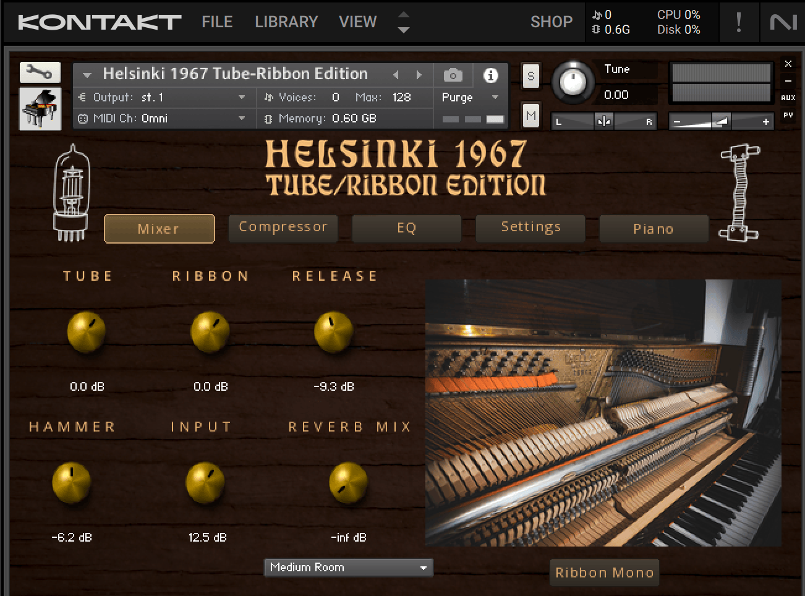
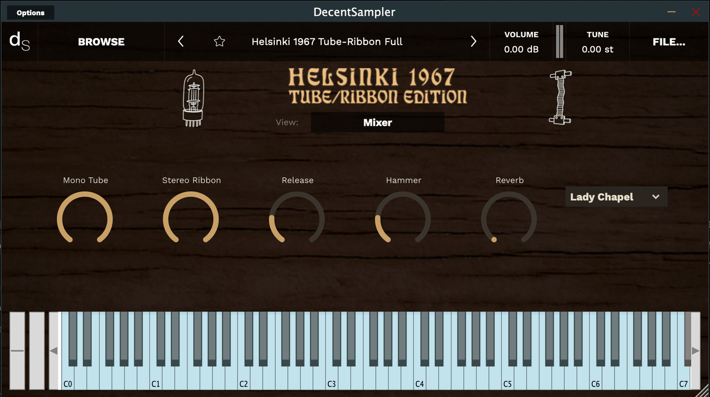
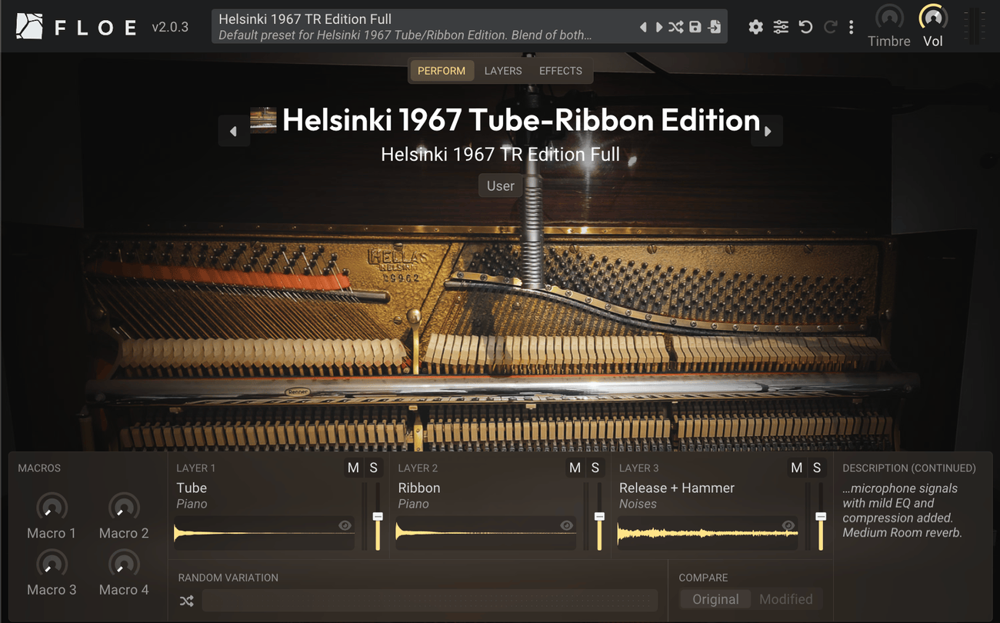

  

# Helsinki 1967 Tube/Ribbon Edition

A free sampled upright piano from 1967, recorded with two microphones of opposite character: a modified tube condenser in mono and a stereo ribbon in a Blumlein pair. Use either one, or blend them.

**[Download](../../releases/latest)** · [Project page](https://mikkopatama.com/Helsinki1967) · [Video](https://www.youtube.com/watch?v=rO6eh6xXX_U)

## Formats

- Kontakt 7
- DecentSampler
- Floe
- Logic Pro Sampler
- Ableton Live Sampler

DecentSampler and Floe builds are FLAC-compressed. The full library is under 2 GB.

## Microphones

| Channel | Microphone | Character |
|---|---|---|
| **Tube** (mono) | Custom modified CV-12 with an RM CK-12 capsule and a low-noise 6072 tube. Two ill-behaving capacitors removed from the circuit. | Very bright, full and refined. Cuts through a mix easily. |
| **Ribbon** (stereo) | Stereo ribbon microphone in a Blumlein array. | Rounder, with a softened attack. Wide and natural, with room reflections. |

The piano's hammers are badly worn in the mid-register, which makes the attack almost tacky. The ribbon softens it, and the tube condenser is placed far enough away to avoid it.

Play the Tube channel alone to sit in a busy mix, the Ribbon alone for a rounder, wider sound, or blend both for a natural player-position sound. The Kontakt version can also sum the ribbon to mono, which gives the darkest, most retro sound.

## Specifications

- 35 sampled keys
- 5 velocity layers per key
- 35 release samples, one per key
- Release hammer noise
- Round-robins
- 2 microphones
- Convolution reverb with the Lady Chapel (St Albans Cathedral), Small Room, Plate and Grandmother Spring impulse responses

## Screenshots

| Kontakt 7 | DecentSampler | Floe |
|---|---|---|
|  |  |  |

## The piano

The piano was built in Nurmijärvi, Finland, in 1967. The name "Helsinki 1967" comes from the text inside it: Helsinki No 9962 (serial number). The factory moved from Helsinki to Nurmijärvi in 1951, so this piano was very likely not built in Helsinki.

The sample library was recorded in summer 2023 in the author's rehearsal space, a room treated to sound dry.

## The original

The first Helsinki 1967 library used five microphones and 26 sampled keys. It is available on [Pianobook](https://www.pianobook.co.uk/packs/helsinki-1967-pro/).

## Credits

Lady Chapel, St Albans Cathedral impulse response: [OpenAIR](http://www.openairlib.net), Audiolab, University of York. Marcin Gorzel, Gavin Kearney, Aglaia Foteinou, Sorrel Hoare, Simon Shelley. Licensed under [CC BY 4.0](https://creativecommons.org/licenses/by/4.0/).

Small Room, Plate and Grandmother Spring impulse responses recorded by Mikko Patama.

## License

Free to use in any music or audio production, commercial or non-commercial. The samples and instrument files may not be sold, repackaged or redistributed. See [LICENSE](LICENSE) for the full terms.

## Support

If you enjoy the samples, consider [buying me a coffee](https://buymeacoffee.com/mikkopatama).

Made by [Mikko Patama](https://mikkopatama.com).
